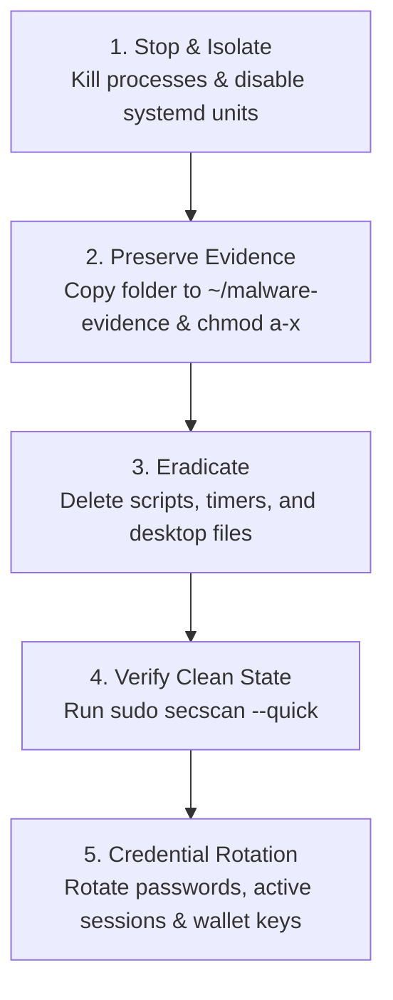

# Secscan - Linux Host Security Auditor & Intrusion Scanner

A fast, standalone host security auditing and behavioral intrusion detection CLI for **Linux (tuned for CachyOS / Arch Linux)**, written in Go with **zero third-party dependencies**.

`secscan` analyzes system configurations, detects persistence, exposes unpatched vulnerabilities, and looks for active malware indicators (like crypto clipboard hijackers, reverse shells, and rootkits). Every scan produces an **actionable, prioritized remediation plan** with specific commands to fix each issue, saves structured JSON/Markdown reports, and tracks changes over time using baseline diffing.

---

```text
secscan 1.0.1  |  myhost  |  CachyOS Linux  |  kernel 7.3.3-1-cachyos
Scanned 2026-11-12 12:29:23 in 59.7s

Security score: Grade B  (84/100)   coverage: 29/29 checks ran
  critical 0 | high 0 | medium 2 | low 4 | info 3 | suppressed 2

ACTION PLAN: THIS WEEK (medium)
  1. [MEDIUM] NET-DOCKER-EXPOSED: Use 127.0.0.1:HOST:CONTAINER in -p / compose ports
  2. [MEDIUM] PATCH-PENDING: sudo pacman -Syu
```

> [!NOTE]
> **Safety First:** `secscan` is strictly read-only. It never modifies, deletes, or breaks your files or services. (The only external operations are optional signature refreshes: `freshclam` and `rkhunter --update` when those optional tools are enabled).

---

## Table of Contents

- [Key Features](#key-features)
- [Quick Start](#quick-start)
- [Prerequisites & Dependencies](#prerequisites--dependencies)
- [Daily & Weekly Routine](#daily--weekly-routine)
- [Command-Line Reference](#command-line-reference)
- [Understanding the Report & Scores](#understanding-the-report--scores)
  - [Honest Scoring & Coverage Tracking](#honest-scoring--coverage-tracking)
  - [Severity Levels](#severity-levels)
  - [Action Plan (Do Now / This Week / Later)](#action-plan-do-now--this-week--later)
- [Baseline Diffing (Tracking Changes)](#baseline-diffing-tracking-changes)
- [Complete List of Checks](#complete-list-of-checks)
- [Configuration & Suppressing False Alarms](#configuration--suppressing-false-alarms)
- [What to Do If Malware or Threat Is Detected](#what-to-do-if-malware-or-threat-is-detected)
- [Automation (Systemd Timer)](#automation-systemd-timer)
- [Development & Testing](#development--testing)

---

## Key Features

1. **Behavioral Intrusion & Malware Detection**:
   - Flags suspicious scripts running from `~/.config`, `~/.local`, or `/tmp`.
   - Discovers **disguised systemd services** (e.g. malware imitating GNOME or KDE components).
   - Detects **clipboard hijackers** (malware watching for Bitcoin/Ethereum/Solana wallet addresses to swap them).
   - Hunts for hidden processes and rootkits (`kill(0)` vs `/proc` discrepancy).
   - Flags suspicious outbound internet connections (e.g. from deleted or temp-dir binaries).

2. **Action-Oriented Reports**:
   - Categorizes every finding into an exact action plan: **Do Now** (Critical/High), **This Week** (Medium), and **When Convenient** (Low).
   - Every finding provides the root cause (_"why"_) and a drop-in shell command (_"fix"_).

3. **Honest Scoring & No False All-Clears**:
   - Scores report actual test coverage (e.g., `29/29 checks ran`).
   - If internet is offline or checks fail, `secscan` **caps the grade** and lists the gaps instead of reporting a false-clean score.

4. **Diffing Against Previous Runs**:
   - Fingerprints each issue to highlight new problems (`[NEW]`) and celebrate fixed ones (`RESOLVED`).

5. **No Bloat**:
   - Compiles into a single lightweight binary with pure Go standard library. Runs in parallel across CPU cores.

---

## Quick Start

### 1. Build and Install

```bash
# Clone the repository
git clone https://github.com/yourusername/SecurityGoScaner.git secscan
cd secscan

# One-command build and install (runs tests, builds, and installs):
make install
# (or run: ./publish.sh)

# Verify installation
secscan --version
```

### 2. Run Your First Scan

#### Audit Your Host PC:
Run with `sudo` for full access to inspect root processes, listening sockets, and security modules:
```bash
sudo secscan
```

#### Scan Untrusted Repositories & Zip Archives (`code-scan`):
Before running, building, or opening an untrusted project or download:
```bash
# Scan a project folder (runs inside isolated, network-less Docker by default)
secscan code-scan ~/Downloads/untrusted-repo

# Scan a ZIP archive directly WITHOUT unzipping to your host disk:
secscan code-scan ~/Downloads/suspicious-project.zip

# Fast native in-memory scan (without Docker):
secscan code-scan --no-docker ~/Downloads/untrusted-repo
secscan code-scan --no-docker ~/Downloads/archive.zip
```

View your saved report anytime in Markdown format:

```bash
glow ~/.local/share/secscan/report-*.md   # or open with your favorite editor
```

---

## Prerequisites & Dependencies

- **OS**: Linux with `systemd` (tuned for **Arch Linux / CachyOS**; package integrity checks require `pacman`).
- **Build tool**: Go 1.21+

### Optional Companion Tools

`secscan` works out of the box using Linux system APIs. If companion security tools are installed, it automatically orchestrates and parses them. Missing tools are cleanly skipped with helpful hints:

| Tool           | Arch / CachyOS Package | What It Adds                                                       |
| :------------- | :--------------------- | :----------------------------------------------------------------- |
| `checkupdates` | `pacman-contrib`       | Safe checking of pending security updates                          |
| `arch-audit`   | `arch-audit`           | Real-time CVE database matching                                    |
| `rkhunter`     | `rkhunter`             | Rootkit detection (pre-filtered for Arch false alarms)             |
| `lynis`        | `lynis`                | In-depth system configuration and hardening audit                  |
| `clamscan`     | `clamav`               | Antivirus signature scanning (optional via `--clamav` or `--full`) |

To install all recommended tools on Arch / CachyOS:

```bash
sudo pacman -S --needed go pacman-contrib arch-audit rkhunter lynis clamav
```

---

## Daily & Weekly Routine

| When                     | Command                | Estimated Time    | What It Does                                                                           |
| :----------------------- | :--------------------- | :---------------- | :------------------------------------------------------------------------------------- |
| **Daily / Pre-Commit**   | `sudo secscan --quick` | **~2–4 seconds**  | Runs fast checks: persistence, active processes, ports, logins, CVEs, malware IOCs.    |
| **Weekly**               | `sudo secscan`         | **~1 minute**     | Daily checks + rootkit audit (`rkhunter`) + package integrity (`pacman -Qkk`) + Lynis. |
| **Monthly / Deep Audit** | `sudo secscan --full`  | **10–30 minutes** | Everything above + comprehensive ClamAV file system signature scan.                    |

---

## Command-Line Reference

```bash
# Fast daily scan
sudo secscan --quick

# Full scan including ClamAV malware signatures
sudo secscan --full

# Verbose: show all evidence lines instead of the first 6
sudo secscan -v

# Target specific checks
sudo secscan --only persist-systemd,ioc-scripts,procs

# Skip specific long-running checks
sudo secscan --skip lynis,rkhunter

# Output pure JSON for scripting or pipelines
sudo secscan --json | jq '.results[].findings[]'

# List all available checks and their IDs
secscan --list

# Fail CI/CD or scripts if any High/Critical finding is present
sudo secscan --fail-on high
```

### Full Options

| Flag                | Default                               | Description                                                                                                   |
| :------------------ | :------------------------------------ | :------------------------------------------------------------------------------------------------------------ |
| `--quick`           | `false`                               | Skips slow checks (`integrity`, `fs-suid`, `rkhunter`, `lynis`, `kmod`, `clamav`).                            |
| `--full`            | `false`                               | Enables every check including `clamav`.                                                                       |
| `--clamav`          | `false`                               | Enables ClamAV file scanning without forcing other checks.                                                    |
| `--clamav-paths`    | `$HOME, /tmp, /opt, /usr/local, /srv` | Comma-separated directories scanned by ClamAV.                                                                |
| `--clamav-timeout`  | `2h`                                  | Maximum execution time allowed for ClamAV.                                                                    |
| `--only <ids>`      | `""`                                  | Comma-separated list of check IDs to run exclusively.                                                         |
| `--skip <ids>`      | `""`                                  | Comma-separated list of check IDs to skip.                                                                    |
| `--jobs <n>`        | `4`                                   | Number of parallel worker threads.                                                                            |
| `--json`            | `false`                               | Emits report to stdout in JSON format (progress logs go to stderr).                                           |
| `-v`                | `false`                               | Verbose mode: prints all evidence lines without truncation.                                                   |
| `--show-suppressed` | `false`                               | Lists findings that were silenced by your config file.                                                        |
| `--no-color`        | `false`                               | Disables ANSI terminal colors (automatically disabled when piped).                                            |
| `--no-save`         | `false`                               | Runs scan in-memory without saving report files or moving baseline.                                           |
| `--out <dir>`       | `~/.local/share/secscan`              | Custom directory to save reports and baseline.                                                                |
| `--config <path>`   | `~/.config/secscan/config.json`       | Custom path to configuration file.                                                                            |
| `--init-config`     | `false`                               | Generates a starter `config.json` and exits.                                                                  |
| `--fail-on <level>` | `high`                                | Exits with status `1` if an unsuppressed finding is at or above: `info`, `low`, `medium`, `high`, `critical`. |

### Exit Codes

- `0`: Scan finished cleanly; no findings at or above `--fail-on`.
- `1`: Security findings detected at or above `--fail-on` threshold.
- `2`: Bad configuration or invalid command-line flags.
- `3`: Execution error; one or more checks failed (e.g. tool crashed or network failed).

---

## Codebase & Project Malware Scanner (`secscan code-scan`)

Protect your PC **before** running, building, or installing untrusted code from GitHub, recruiters, freelance clients, or downloaded archives.

```bash
secscan code-scan [flags] <target-directory | archive.zip>
```

### Safety Features
- **Docker by Default**: The codebase is mounted read-only (`:ro`) into a locked-down, disposable container with `--network none`, `--cap-drop ALL`, `--security-opt no-new-privileges`, and read-only root filesystem. The container is completely deleted when finished.
- **Zip Scanning Without Extracting**: You can pass a `.zip` archive directly. It is read completely in-memory without ever unzipping or extracting malicious files onto your host disk!
- **Zero Execution**: Target files are never executed, imported, or compiled. No `npm install`, `pip install`, `go run`, or build scripts are triggered.
- **Native Fast Mode (`--no-docker`)**: If Docker is not installed or you want instant in-memory scanning, `--no-docker` runs Go's safe static analyzer directly in memory in milliseconds.

### Code-Scan Flags

| Flag | Default | Description |
| :--- | :--- | :--- |
| `<target>` | *(required)* | Path to project directory or `.zip` archive. |
| `--password <pass>` | `""` | Password for encrypted/locked ZIP archives (prompts interactively if omitted). |
| `--no-docker` | `false` | Run native in-memory scan directly on host without Docker. |
| `--min-severity` | `info` | Minimum severity to report: `info`, `low`, `medium`, `high`, `critical`. |
| `--json` | `false` | Output findings in machine-readable JSON format. |
| `--out <path>` | `""` | Save Markdown report or JSON file outside the target. |
| `-v` | `false` | Verbose output mode. |

### What `code-scan` Hunts:
- **Reverse Shells**: `/dev/tcp`, `bash -i`, Netcat relays, PowerShell TCPClient, Python/Node socket-to-shell wiring.
- **Crypto Clipboard Address Hijackers**: Detects detect-and-replace loops swapping Bitcoin/Ethereum/Solana addresses.
- **Rootkits & Hooks**: References to `/etc/ld.so.preload`, `LD_PRELOAD`, `sys_call_table`, eBPF rootkits, PAM backdoors.
- **Persistence Injection**: Secret writes to `~/.ssh/authorized_keys`, crontabs, `.bashrc`, disguised systemd units.
- **Obfuscated Loaders**: `eval(atob(...))`, `exec(base64)`, `curl | sh`, PowerShell encoded commands.
- **Credential Exfiltration**: Discord/Telegram webhooks, MetaMask/wallet files, browser credential stores (`Login Data`).
- **Supply Chain Threats**: Dangerous `package.json` install hooks (`preinstall`, `postinstall`).
- **Trojan Source & Obfuscation**: Bidirectional Unicode characters (`\u202E`), double-extension files (`.pdf.exe`).
- **Hidden Compiled Binaries**: Embedded ELF, PE, Mach-O binaries (`.so`, `.dll`, `.exe`).

---

## Understanding the Report & Scores

### Honest Scoring & Coverage Tracking

The score starts at **100** and subtracts penalties for unsuppressed findings:

$$\text{Score} = 100 - (30 \times \text{Critical}) - (12 \times \text{High}) - (4 \times \text{Medium}) - (1 \times \text{Low})$$

- **A** (90–100) | **B** (75–89) | **C** (60–74) | **D** (40–59) | **F** (<40)

> [!IMPORTANT]
> **Grade Capping:** If a scan has blind spots (e.g., ran without `sudo`, tools failed, or internet error during CVE fetch), `secscan` **caps your grade** (capped at B or C) and displays an explicit warning. A scan that cannot inspect everything will never report a false Grade A.

### Severity Levels

- **CRITICAL (-30 pts)**: Active compromise or open backdoors (e.g., hidden PIDs, cryptominers, unauthorized root UID 0 accounts, `/etc/ld.so.preload` hooks).
- **HIGH (-12 pts)**: Urgent threats or major misconfigurations (e.g., disguised systemd malware, clipboard hijackers, unowned SUID binaries, disabled firewall, world-readable shadow file).
- **MEDIUM (-4 pts)**: Exposures needing remediation (e.g., Docker ports exposed to LAN, unpatched packages, unowned scripts running from user config).
- **LOW (-1 pt)**: Hardening improvements (e.g., kernel sysctl parameters, disabled Secure Boot, stale in-memory binaries needing reboot).
- **INFO (0 pts)**: Auditing checklists (e.g., list of foreign AUR packages, desktop autostart apps).

### Action Plan (Do Now / This Week / Later)

Every terminal scan and Markdown report automatically structures findings into an immediate roadmap:

1. **DO NOW (Critical / High)**: Isolate or neutralize immediately.
2. **THIS WEEK (Medium)**: Apply package upgrades, bind ports to localhost, or fix service configs.
3. **WHEN CONVENIENT (Low)**: Apply kernel sysctl hardening or firmware adjustments.

---

## Baseline Diffing (Tracking Changes)

Each finding is assigned a unique cryptographic fingerprint based on its identity and evidence. When `secscan` runs, it compares the current results against `~/.local/share/secscan/latest.json`:

- **`[NEW]`**: Any problem that appeared since the previous scan is highlighted in magenta.
- **`RESOLVED`**: Any finding that was successfully remediated is celebrated in a green summary block.

---

## Complete List of Checks

`secscan` runs up to **29 layered checks**:

| Check ID            | Category    | What It Inspects                                                        | Key Findings                                                               |
| :------------------ | :---------- | :---------------------------------------------------------------------- | :------------------------------------------------------------------------- |
| `patch-updates`     | Patching    | Pending system updates via `checkupdates`                               | `PATCH-PENDING`                                                            |
| `patch-reboot`      | Patching    | Kernel mismatch with disk modules (reboot required)                     | `PATCH-REBOOT`                                                             |
| `cve-audit`         | Patching    | Known vulnerabilities via `arch-audit`                                  | `CVE-FIXABLE`, `CVE-UNFIXED`                                               |
| `integrity`         | Integrity   | Modified system binaries in `/usr/bin`, `/usr/lib`, `/boot`             | `INTEG-MODIFIED`, `INTEG-METADATA`                                         |
| `foreign-pkgs`      | Integrity   | AUR and untracked manual packages (`pacman -Qm`)                        | `PKG-FOREIGN`                                                              |
| `ld-preload`        | Integrity   | Malicious `/etc/ld.so.preload` rootkit injection                        | `INTEG-LDPRELOAD`                                                          |
| `kmod`              | Integrity   | Loaded kernel modules not owned by any package                          | `KMOD-UNOWNED`, `KMOD-DKMS`                                                |
| `secureboot`        | Hardening   | UEFI Secure Boot enforcement status                                     | `BOOT-SECUREBOOT`                                                          |
| `sysctl`            | Hardening   | Kernel hardening parameters (bpf, ptracing, dumpable)                   | `HARD-SYSCTL`                                                              |
| `lynis`             | Hardening   | Full system audit via `lynis`                                           | `LYNIS-WARN`, `LYNIS-SUGGEST`                                              |
| `net-listen`        | Network     | Ports open and listening on external interfaces                         | `NET-LISTEN-<proto>-<port>`                                                |
| `net-docker`        | Network     | Containers bypassing firewall by publishing to `0.0.0.0`                | `NET-DOCKER-EXPOSED`                                                       |
| `net-firewall`      | Network     | Status of `ufw`, `nftables`, or `firewalld`                             | `NET-FIREWALL`                                                             |
| `net-outbound`      | Network     | Connections made by temp-dir binaries, hidden scripts, or stale apps    | `NET-OUTBOUND-SUSPICIOUS`, `NET-OUTBOUND-STALE`, `NET-OUTBOUND-UNPACKAGED` |
| `accounts`          | Access      | Unauthorized UID 0 users, empty passwords, sudo `NOPASSWD`              | `ACCT-UID0`, `ACCT-SHADOW-PERMS`, `ACCT-EMPTY-PW`, `ACCT-SUDO-NOPASSWD`    |
| `ssh`               | Access      | Insecure SSH settings (`PermitRootLogin`) & `authorized_keys`           | `SSH-RUNNING`, `SSH-AUTHKEYS`                                              |
| `logins`            | Access      | Remote network logins and brute-force attempts                          | `AUTH-REMOTE-LOGIN`, `AUTH-FAILED`                                         |
| `persist-systemd`   | Persistence | Unpackaged systemd units, **disguised system names**, stealth logging   | `PERSIST-UNIT-DISGUISED`, `PERSIST-UNIT-SUSPICIOUS`, `PERSIST-UNIT-CUSTOM` |
| `persist-cron`      | Persistence | Scheduled jobs in `/etc/cron*` and user crontabs                        | `PERSIST-CRON-SUSPICIOUS`, `PERSIST-CRON`                                  |
| `persist-autostart` | Persistence | Desktop `.desktop` entries in user & system autostart                   | `PERSIST-AUTOSTART-SUSPICIOUS`, `PERSIST-AUTOSTART`                        |
| `persist-shellrc`   | Persistence | Malicious reverse-shells or downloads in `.bashrc`, `.zshrc`            | `PERSIST-SHELLRC`                                                          |
| `persist-misc`      | Persistence | Startup scripts in `profile.d`, `udev`, `environment.d`, `~/.local/bin` | `PERSIST-MISC-SUSPICIOUS`, `PERSIST-MISC`                                  |
| `ioc-scripts`       | Malware     | Files matching **clipboard hijackers** or known malware signatures      | `MAL-CLIPBOARD-HIJACK`                                                     |
| `rkhunter`          | Malware     | Rootkit heuristics via `rkhunter`                                       | `RKH-ROOTKIT`, `RKH-WARN`                                                  |
| `clamav`            | Malware     | Deep signature file scan via `clamscan`                                 | `AV-FOUND`, `AV-LIKELY-FP`                                                 |
| `procs`             | Runtime     | Cryptominers (`xmrig`), deleted executables, `/tmp` processes           | `PROC-MINER`, `PROC-TMP-EXEC`, `PROC-DELETED-BIN`                          |
| `proc-scripts`      | Runtime     | Interpreters (`node`, `python`, `sh`) running hidden scripts            | `PROC-MALICIOUS-SCRIPT`, `PROC-HIDDEN-SCRIPT`                              |
| `proc-hidden`       | Runtime     | Hidden PIDs responding to signals but missing from `/proc`              | `PROC-HIDDEN-PID`                                                          |
| `fs-suid`           | Filesystem  | Dangerous unowned SUID/SGID privilege escalation binaries               | `FS-SUID-UNOWNED`                                                          |
| `fs-tmp`            | Filesystem  | Executables and ELF binaries staged in `/tmp`, `/dev/shm`               | `FS-TMP-ELF`, `FS-TMP-EXEC`                                                |

---

## Configuration & Suppressing False Alarms

To generate the configuration file:

```bash
secscan --init-config
```

This writes to `~/.config/secscan/config.json`.

### Example Configuration

You can suppress legitimate local services (e.g. local KDE Connect sync, custom desktop plugins) so your reports stay clean:

```json
{
  "suppress": [
    {
      "id": "PROC-HIDDEN-SCRIPT",
      "reason": "Smart video wallpaper KDE plugin"
    },
    {
      "id": "NET-LISTEN-tcp-1716",
      "reason": "KDE Connect phone sync"
    },
    {
      "id": "NET-LISTEN-udp-*",
      "reason": "Local discovery services (mDNS / LLMNR)"
    }
  ],
  "allowed_ports": [1716, 5353, 5355],
  "clamav_paths": [],
  "ignore_tool_warnings_regex": []
}
```

- Suppressions accept exact IDs or wildcards ending in `*`.
- Always provide a clear `"reason"` for auditability.
- View suppressed findings anytime with `secscan --show-suppressed`.

---

## What to Do If Malware or Threat Is Detected

If `secscan` alerts on `CRITICAL` or `HIGH` threats (such as `MAL-CLIPBOARD-HIJACK` or `PERSIST-UNIT-DISGUISED`):



1. **Do not copy/paste passwords, seed phrases, or crypto addresses** while a clipboard hijacker or keylogger is detected.
2. **Stop the process and persistence**:
   ```bash
   systemctl --user disable --now <suspicious-unit>.service
   pkill -f <malware-name>
   ```
3. **Preserve evidence safely**:
   ```bash
   cp -a ~/.config/<suspicious-folder> ~/malware-evidence
   find ~/malware-evidence -type f -exec chmod a-x {} +
   ```
4. **Wipe persistence files**:
   Remove the unit files, desktop launchers, and staging directories:
   ```bash
   rm -rf ~/.config/<suspicious-folder>
   rm -f ~/.config/systemd/user/<suspicious-unit>.service
   systemctl --user daemon-reload
   ```
5. **Verify with secscan**:
   ```bash
   sudo secscan --quick
   ```
   Ensure the finding appears in **RESOLVED since last run** and `HIGH` is at `0`.
6. **Rotate Credentials**:
   Change passwords and browser sessions from a clean device.

---

## Automation (Systemd Timer)

To run `secscan` automatically in the background and log findings:

### 1. Create the Service File

`/etc/systemd/system/secscan.service`:

```ini
[Unit]
Description=Secscan Security Audit
After=network-online.target

[Service]
Type=oneshot
ExecStart=/usr/local/bin/secscan --quick --no-color --out /home/youruser/.local/share/secscan
User=root
```

### 2. Create the Daily Timer

`/etc/systemd/system/secscan.timer`:

```ini
[Unit]
Description=Daily Secscan Audit

[Timer]
OnCalendar=daily
Persistent=true

[Install]
WantedBy=timers.target
```

### 3. Enable and Monitor

```bash
sudo systemctl daemon-reload
sudo systemctl enable --now secscan.timer

# View past run logs
journalctl -u secscan.service -n 50
```

---

## Development & Testing

Built with standard Go tools:

```bash
# Format code
gofmt -w .

# Run static analysis
go vet ./...

# Run automated test suite
go test -v ./...

# Compile local binary
go build -o secscan .
```

### Code Structure

- [`main.go`](file:///home/hasnat/My_Projects/My_Work/SecurityGoScaner/main.go): CLI flags, runner orchestration, report rendering (terminal, Markdown, JSON), and configuration handling.
- [`detect.go`](file:///home/hasnat/My_Projects/My_Work/SecurityGoScaner/detect.go): Behavioral intrusion detection logic, clipboard hijacker heuristics, disguised unit scoring, rootkit detection, and outbound connection analysis.
- [`main_test.go`](file:///home/hasnat/My_Projects/My_Work/SecurityGoScaner/main_test.go): Automated unit tests covering scoring, regex rules, fake unit detection, and coverage capping.

---

## License

MIT License. Built for personal and production Linux workstation auditing.
